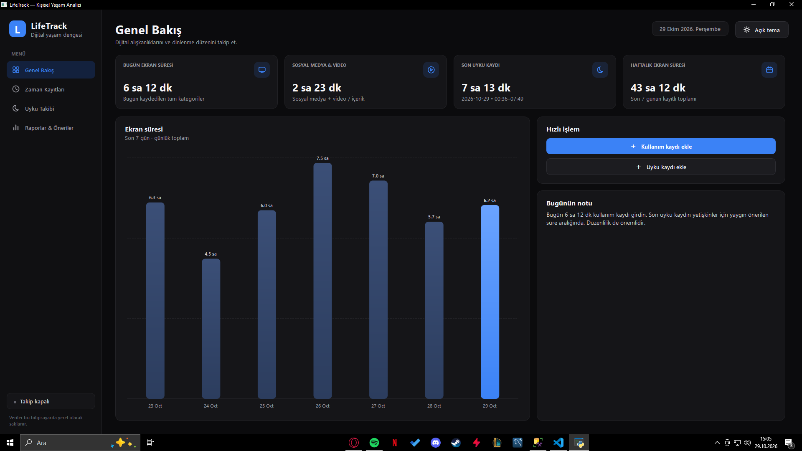
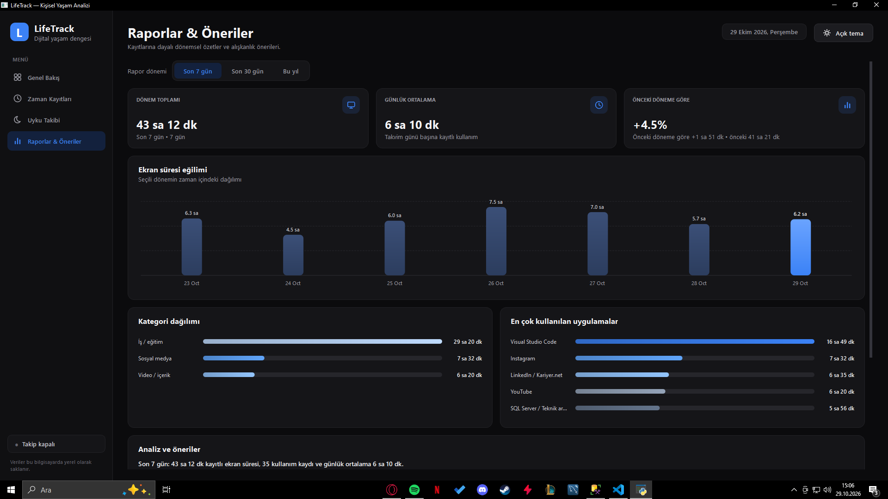
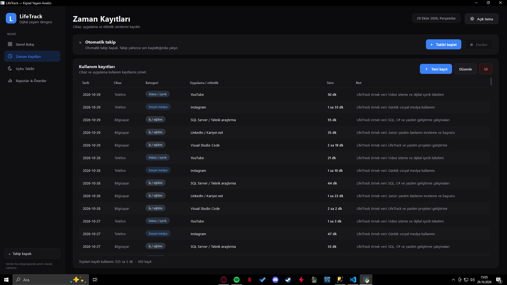

# LifeTrack — Screen Time & Sleep Tracker


Windows için Python, PySide6 ve Microsoft SQL Server kullanılarak geliştirilmiş masaüstü takip uygulaması.

LifeTrack; ekran kullanım sürelerini ve uyku kayıtlarını tek bir arayüzde yönetmeyi, günlük alışkanlıkları analiz etmeyi ve dönemsel raporlar üzerinden değişimleri incelemeyi sağlar.

> **Proje durumu:** MVP  
> **Platform:** Windows 10/11  
> **Arayüz dili:** Türkçe

## Özellikler

- **Dashboard:** Günlük özetler ve son 7 güne ait ekran kullanım grafiği.
- **Ekran süresi yönetimi:** Kayıt ekleme, düzenleme ve silme (CRUD).
- **Uyku takibi:** Yatış ve kalkış saatlerine göre uyku süresini hesaplama.
- **Raporlama:** Son 7 gün, son 30 gün ve yıl içi verileri inceleme.
- **Karşılaştırmalı analiz:** Önceki dönemlerle süre ve kategori karşılaştırmaları.
- **Otomatik takip:** Kullanıcının başlattığı oturumda aktif Windows uygulamasının işlem adını ve kullanım süresini kaydetme.
- **Arayüz:** Koyu ve açık tema desteği.
- **Veri yönetimi:** Microsoft SQL Server üzerinde yerel veri saklama ve giriş doğrulama.

## Ekran Görüntüleri

### Genel Bakış


### Raporlar


### Zaman Kayıtları


## Teknolojiler

| Alan | Teknoloji |
|---|---|
| Programlama dili | Python |
| Masaüstü arayüzü | PySide6 |
| Veritabanı | Microsoft SQL Server |
| Veritabanı bağlantısı | pyodbc |
| Veri analizi ve raporlama | Python |
| Test | unittest |

## Gereksinimler

- Windows 10 veya Windows 11
- Python 3.10 veya üzeri
- Microsoft SQL Server (Express veya Developer)
- ODBC Driver 17 for SQL Server
- SQL Server veritabanına erişim yetkisi

## Kurulum

### 1. Projeyi indir

```powershell
git clone https://github.com/Umut-Erdon/LifeTrack.git
cd LifeTrack
```

Git kullanmıyorsan GitHub sayfasından **Code → Download ZIP** seçeneğiyle projeyi indirebilirsin.

### 2. Sanal ortamı oluştur

```powershell
py -m venv .venv
.\.venv\Scripts\Activate.ps1
```

### 3. Bağımlılıkları yükle

```powershell
python -m pip install --upgrade pip
pip install -r requirements.txt
```

### 4. SQL Server bağlantısını yapılandır

`database.py` içindeki varsayılan bağlantı ayarlarını kendi SQL Server ortamına göre kontrol et.

Örnek ortam değişkenleri:

```powershell
$env:LIFETRACK_SQL_SERVER = "SUNUCU_ADI\SQLEXPRESS"
$env:LIFETRACK_SQL_DATABASE = "LifeTrack"
$env:LIFETRACK_ODBC_DRIVER = "ODBC Driver 17 for SQL Server"
```

Bu değerler yalnızca örnektir. Kendi SQL Server sunucu adını ve kurulumunu kullanmalısın.

### 5. Veritabanını hazırla

```powershell
python setup_database.py
```

### 6. Uygulamayı çalıştır

```powershell
python app.py
```

Alternatif olarak Windows'ta `Baslat.bat` dosyasını kullanabilirsin.

## Testler

Testler için ayrı bir `LifeTrack_Test` veritabanı kullanılır.

```powershell
python setup_test_database.py
python -m unittest discover -s tests -v
```

Test veritabanının doğru yapılandırıldığından emin olmadan testleri çalıştırma.

## Demo Verileri

Grafiklerin ve raporların dolu görünmesi için iki yoldan biriyle örnek veri oluşturabilirsin.

> **Uyarı:** Demo verilerini gerçek kişisel kayıtların bulunduğu veritabanında oluşturma. Demo için ayrı bir veritabanı kullanılması önerilir (`LIFETRACK_SQL_DATABASE` ortam değişkeniyle ayarlanabilir).

### Seçenek 1: Python betiği

```powershell
python seed_demo_data.py
```

Veritabanında herhangi bir kayıt varsa ekleme yapmaz.

### Seçenek 2: SQL betiği

`seed_demo_data.sql` dosyasını SQL Server Management Studio'da (SSMS) açıp çalıştır. Betik son 90 gün için örnek veri üretir:

- Her gün 5 farklı ekran kullanım kaydı (Visual Studio Code, LinkedIn / Kariyer.net, SQL Server araştırması, Instagram, YouTube)
- Her gün 1 uyku kaydı (yatış ve kalkış saatleri süreyle uyumlu)
- Hafta sonları iş / eğitim sürelerini daha kısa tutar

Üretilen tüm kayıtların notu `LifeTrack örnek veri:` ile başlar. Betik her çalıştırmada önce yalnızca bu notlu eski örnek kayıtları siler, sonra yenilerini ekler. Notu farklı olan gerçek kayıtlara dokunmaz. Örnek verileri tamamen kaldırmak için betiğin ilk bölümündeki iki `DELETE` komutunu tek başına çalıştırman yeterlidir.

> Bu betik veritabanının boş olup olmadığını kontrol etmez. Örnek kayıtlar gerçek kayıtlarla aynı raporlarda görüneceği için ayrı bir demo veritabanında kullanılmalıdır.

## Gizlilik

Otomatik takip özelliği kullanıcı tarafından başlatılır ve durdurulabilir.

- Etkin uygulamanın işlem adı ve kullanım süresi kaydedilir.
- Pencere başlığı, yazılan metin, web adresi, ekran görüntüsü ve klavye içeriği kaydedilmez.
- 60 saniyeden uzun hareketsizlikte sayaç duraklar.
- Veriler, yapılandırılan SQL Server veritabanında saklanır.

## Proje Yapısı

```text
LifeTrack/
├── app.py
├── database.py
├── analytics.py
├── automatic_tracker.py
├── setup_database.py
├── setup_test_database.py
├── seed_demo_data.py
├── seed_demo_data.sql
├── requirements.txt
├── Baslat.bat
├── dashboard.png
├── raporlar.png
├── zaman-kayitlari.png
├── docs/
└── tests/
```

## Geliştirme Hedefleri

- Kurulum sürecini kolaylaştırmak
- Raporlama ve veri görselleştirme özelliklerini geliştirmek
- Test kapsamını genişletmek
- Uygulama dağıtımını kolaylaştırmak

## Geliştirici

**Umut Erdön**

- GitHub: [Umut-Erdon](https://github.com/Umut-Erdon)
- Proje: [LifeTrack](https://github.com/Umut-Erdon/LifeTrack)
